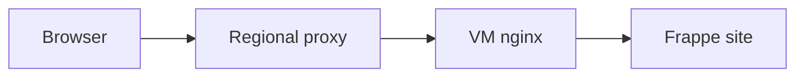

# Domains and routing

A public domain must lead to the right VM and the right site inside it. DNS directs visitors to the regional proxy. The proxy selects the VM. The VM's nginx web server selects the site.



## Domain routing

Cloud uses automatic names and explicit routes.

| Name | How the proxy finds the VM |
| --- | --- |
| `admin-vm-<label>.<regional-zone>` | Decodes the label to reach Pilot admin. |
| `site-<label>.<regional-zone>` | Decodes the label to reach the prepared site. |
| Customer-chosen regional name | Looks up the stored route for that name. |
| Custom domain | Uses a route after Central checks DNS ownership. |

An automatic name contains the VM number and tenant ID. Central combines them into a label using digits and letters. The proxy decodes the label to find the VM's private address without a stored route.

The expression is `base36((VM number << 32) | tenant)`.

Wildcard DNS already reaches the proxy, so automatic names need no per-VM proxy registration or Site Domain record. They provide an address. Authentication still controls management and login.

For a chosen name, Central owns the Site Domain record and applies the proxy route. It records failures and retries route changes. Saving the customer record alone does not prove that routing works.

## Local hostname aliases

The prepared image initially knows local names such as `admin.local` and `site.local`. Aliases connect the automatic public hostnames to those local destinations.

| Image pattern | Local destination |
| --- | --- |
| `admin-vm-*.region.example.com` | Pilot admin. |
| `*.region.example.com` | The prepared Frappe site. |

Pilot checks the pattern with more fixed text first when aliases overlap.

The site pattern matches every name in the regional zone. A chosen name therefore reaches the prepared site as soon as Central routes it to the VM, before the directory rename. After a rename makes the chosen name primary, Pilot can redirect the site aliases to it.

An alias does not claim a public name. Central must approve a chosen name and route it to this VM. App and Pilot authentication remain separate checks.

## Domain provider

Pilot can run outside Frappe Cloud. Its domain-provider interface delegates external routing to the deployment.

When `bench-domain-provider` is on `PATH`, Pilot calls it for DNS instructions, registration, removal, wildcard domains and proxy addresses.

The Cloud provider calls Central with the server's Pilot credential. Central derives the destination server from that credential, so the caller cannot choose another customer's VM.

For custom domains, Central supplies a DNS recipe with a proxy destination and TXT verification record. Registration checks the TXT record and, for a subdomain, the CNAME before it creates the route.

The provider returns the public scheme, origin scheme and client-IP policy. Pilot configures nginx to trust client information from the provider's proxy addresses. It deregisters during rollback when local creation fails after registration.

## TLS termination

| Domain | TLS and client information |
| --- | --- |
| Regional domain | The proxy uses its wildcard certificate and forwards HTTP with client information to nginx. |
| Custom-domain HTTPS | TLS passes through to the VM. Pilot manages the certificate. Nginx receives PROXY protocol v2 client information. |

A DNS record pointing at the proxy does not make the proxy responsible for a custom domain's certificate.

## Site rename

Central can route a public name before Pilot changes the site's directory. During rename, old nginx workers and queued jobs can still refer to `site.local`.

Pilot prepares a link, then swaps it with the old directory in one step. The old path then points to the new directory:

```text
sites/site.local → sites/chosen.region.example.com
```

Old workers keep finding the files while new configuration uses the new name. This avoids a filesystem gap that could return 404 responses during nginx reload.

Pilot updates the site's API token and keeps recovery state for an incomplete rename. The owning docs define [rename recovery and alias lifetime](https://github.com/frappe/pilot/blob/develop/docs/commands.md#renaming-without-downtime).

The exact integration contracts live in [Pilot's domain provider](https://github.com/frappe/pilot/blob/develop/docs/domain-provider.md) and [Atlas's HTTP proxy](https://github.com/frappe/atlas/blob/develop/docs/networking/http-proxy/index.md).
