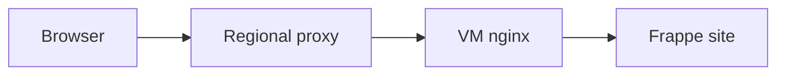

# How a domain reaches a site

A public name must select both a VM and a site inside it. DNS reaches the regional proxy. The proxy selects the VM. The VM's nginx web server selects the site.



## Domain routing

Cloud uses automatic names and explicit routes.

| Name | How the proxy finds the VM |
| --- | --- |
| `admin-vm-<label>.<regional-zone>` | Decodes the label to reach Pilot admin. |
| `site-<label>.<regional-zone>` | Decodes the label to reach the prepared site. |
| Customer-chosen regional name | Looks up the stored route for that name. |
| Custom domain | Uses a route after Central checks DNS ownership. |

An automatic label is `base36((VM number << 32) | tenant)`. The proxy decodes the VM number and tenant to find the mesh address, without a stored route.

Wildcard DNS already reaches the proxy, so automatic names need no per-VM proxy registration or Site Domain record. They provide an address. Authentication still controls management and login.

For a chosen name, Central owns the Site Domain record and applies the proxy route. It records failures and retries route changes. Saving the customer record alone does not prove that routing works.

## Local hostname aliases

The prepared image initially knows local names such as `admin.local` and `site.local`. Aliases connect public hostnames to those local destinations without redirecting the browser.

| Image pattern | Local destination |
| --- | --- |
| `admin-vm-*.region.example.com` | Pilot admin. |
| `*.region.example.com` | The prepared Frappe site. |

Pilot puts the pattern with more literal text first. The admin pattern therefore wins when both patterns match.

Other matching regional names reach the prepared site. This lets a chosen public name work before the physical site rename finishes.

The broad local alias does not claim a public name. Central must approve the name and route it to this VM. App and Pilot authentication remain separate checks.

## Domain provider

Pilot can run outside Frappe Cloud. Its domain-provider interface delegates external routing to the deployment.

When `bench-domain-provider` is on `PATH`, Pilot calls it for DNS instructions, registration, removal, wildcard domains and proxy addresses.

The Cloud provider calls Central with the server's Pilot credential. Central derives the destination server from that credential, so the caller cannot choose another customer's VM.

For custom domains, Central supplies a DNS recipe with a proxy destination and TXT verification record. Registration checks the published records before it creates the route.

The provider returns the public scheme, origin scheme and client-IP policy. Pilot uses these to configure nginx. It deregisters during rollback when local creation fails after registration.

## TLS termination

| Domain | TLS and client information |
| --- | --- |
| Regional domain | The proxy uses its wildcard certificate and forwards HTTP with client information to nginx. |
| Custom-domain HTTPS | TLS passes through to the VM. Pilot manages the certificate. Nginx receives PROXY protocol v2 client information. |

A DNS record pointing at the proxy does not make the proxy responsible for a custom domain's certificate.

## Site rename

Central can route a public name before Pilot changes the site's directory. During rename, old nginx workers and queued jobs can still refer to `site.local`.

Pilot atomically exchanges the directory and a compatibility symlink. The old path then resolves to the new directory:

```text
sites/site.local → sites/chosen.region.example.com
```

Old workers keep finding the files while new configuration uses the new name. This avoids a filesystem gap that could return 404 responses during nginx reload.

Pilot updates the site's API token and keeps recovery state for an incomplete rename. The owning docs define [rename recovery and alias lifetime](https://github.com/frappe/pilot/blob/develop/docs/commands.md#renaming-without-downtime).

The exact integration contracts live in [Pilot's domain provider](https://github.com/frappe/pilot/blob/develop/docs/domain-provider.md) and [Atlas's HTTP proxy](https://github.com/frappe/atlas/blob/develop/docs/networking/http-proxy/index.md).
