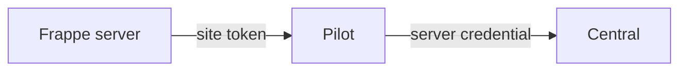

# Cloud controls inside an app

Cloud Settings lets a Frappe site administrator use hosting controls inside the app. Frappe calls Pilot for local work. Pilot calls Central for the allowed Cloud account operations.

## Site-to-Pilot requests

The browser uses its normal Frappe session. Frappe checks access to Cloud Settings, then calls Pilot from the server.

The site configuration supplies a Pilot endpoint and a site-scoped token. That token identifies the real local site and limits its permitted operations.

The browser does not need the host's Central credential. A site token does not grant unrestricted access to every bench or site on the VM.

## Local and Central operations

**Local runtime work** stays with Pilot. It can inspect apps, manage domains or queue permitted site tasks. Changes to shared bench state need further checks.

**Cloud account work** reaches Central. Pilot forwards only an allowed set of methods and the in-app billing API prefix. It reads the server credential from instance metadata for the call.

Central resolves the linked server and team, then applies account and billing rules.

For example:

- **Add a domain:** Frappe calls Pilot's site-domain endpoint. Pilot uses the [domain provider](./domains.md#domain-provider) to register the route through Central, then configures the local destination.
- **View billing:** Frappe calls Pilot's forwarding endpoint. Central returns the relevant account, server and trial information through Pilot.

A queued task can continue after the first response. The panel follows Pilot's task progress to learn the result.

## Server login

The Open server link goes to Central with the Pilot audience. Central resolves the server, checks the signed-in user's access and issues a Pilot login assertion.

A Frappe site administrator does not automatically receive every Cloud server control. Trials can expose the app while server-level controls remain locked.

## Service dependencies

A billing request needs Central to answer. A local operation needs Pilot and the runtime it uses. A background task can continue even if a progress request fails temporarily.

The app's normal page-serving path is separate. An unavailable hosting control does not necessarily stop visitors from using the app.

Implementation starts in the [Frappe Cloud Settings client](https://github.com/frappe/frappe/blob/develop/frappe/integrations/frappe_providers/cloud_settings.py), [Pilot forwarding route](https://github.com/frappe/pilot/blob/develop/admin/backend/api/v1/sites/central.py) and [Central SSO](https://github.com/frappe/central/blob/develop/spec/SSO.md).
