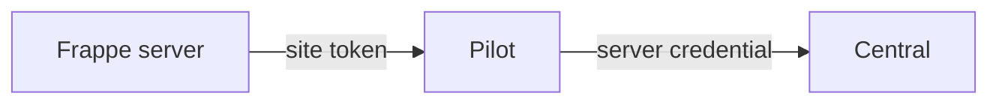

# In-app Cloud

Cloud Settings lets a site administrator use Cloud controls inside a Frappe app. Frappe calls Pilot for work on the VM. Pilot calls Central for allowed account operations.

## Site-to-Pilot requests

The browser uses its normal Frappe session. Frappe checks access to Cloud Settings, then calls Pilot from the server.

The site configuration contains Pilot's address and a token for that site. The token identifies the site and limits what it can do.

The browser does not need the host's Central credential. A site token does not grant unrestricted access to every bench or site on the VM.

## Local and Central operations

Pilot handles local runtime work, such as inspecting apps and queueing permitted site tasks. Some operations also use an external provider. Changes to shared bench state need further checks.

**Cloud account work** reaches Central through `/api/v1/sites/<site>/central/<method>`. Pilot reads the server credential from instance metadata for each call and forwards only these methods:

| Allowed method | Use |
| --- | --- |
| `central.billing.api.billing_api.*` | In-app billing, plans and trial information. |
| `central.api.pilot.heartbeat` | Server heartbeat. |
| `central.api.pilot.get_team_identity_token` | A token that proves the team and its site hostnames to another service. |
| `central.api.email_oauth.start`, `central.api.email_oauth.relay_token` | Email account OAuth. |

Pilot returns `403` for any other method.

Central resolves the linked server and team, then applies account and billing rules.

For example:

- **Add a domain:** Frappe calls Pilot's site-domain endpoint. On Frappe Cloud, Pilot registers the domain through the [domain provider](./domains.md#domain-provider), which calls Central. Without a provider, Pilot verifies the domain locally. Pilot then queues the nginx and certificate setup.
- **View billing:** Frappe calls Pilot's forwarding endpoint. Central returns the relevant account, server and trial information through Pilot.

A queued task can continue after the first response. The panel follows Pilot's task progress to learn the result.

## Server login

The Open server link sends Central the Pilot audience, the identity Pilot expects in its login token. Central finds the server, checks the user's access and issues a signed login token.

A Frappe site administrator does not automatically receive every Cloud server control. Trials can expose the app while server-level controls remain locked.

## Service dependencies

A billing request needs Central to answer. A local operation needs Pilot and the runtime it uses. A background task can continue even if a progress request fails temporarily.

The app serves pages through a separate path. A Cloud control can be unavailable while visitors can still use the app.

Implementation starts in the [Frappe Cloud Settings client](https://github.com/frappe/frappe/blob/develop/frappe/integrations/frappe_providers/cloud_settings.py), [Pilot forwarding route](https://github.com/frappe/pilot/blob/develop/admin/backend/api/v1/sites/central.py) and [Central SSO](https://github.com/frappe/central/blob/develop/spec/SSO.md).
