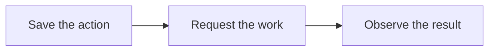

# After creation

Server changes follow the same pattern as signup: save the request, ask the owning service to act and confirm the result.

## Resource actions

Central's Resource Action records the request, authorization context, progress and any accepted regional resource identity.

The console can receive a successful response while the action remains queued or in progress. Completion needs an observation from the service that performs the work.

| Operation | Confirmation |
| --- | --- |
| Start a VM | Atlas observes the requested runtime state. |
| Resize a VM | Atlas observes the requested machine shape. |
| Rename a site | Pilot's rename task completes. |
| Apply a domain | The proxy route change succeeds. |

Atlas compares regional state with host reports. Central follows the regional observations relevant to the customer action.

## Uncertain request outcomes

Suppose Central sends a create request but loses the connection before the answer. The region may already have created the VM.

Central keeps the uncertain action and searches the authorized regional resources for the original request marker. It adopts a matching VM if it finds one.

A completed search with no match can establish failure. An unreachable region leaves the outcome uncertain. Retrying creation immediately could create another server.

Once Central knows the accepted VM identity, recovery continues from that identity. Local finalization can retry without repeating creation.

The [Resource Action contract](https://github.com/frappe/central/blob/develop/central/infrastructure/doctype/resource_action/SPEC.md) defines the exact states and recovery rules.

## Trials and paid service

Central owns trial timing, payment state, conversion, expiry and deletion. The in-app billing panel reads the same trial information as the console.

A trial can allow app use while server controls remain locked. Adding a payment method can start conversion, subject to the team's spending limit. Lifecycle work establishes paid service and removes the restrictions.

An eligible trial VM can sleep after inactivity. Customer traffic wakes it. Paid servers do not follow that trial sleep policy. Resuming a VM does not reinstall its apps.

Ended trials follow Central's retention and deletion policy.

## Snapshots and site backups

An Atlas VM snapshot saves machine state. A Pilot site backup saves Frappe data. They have different scopes and restore procedures.

Cargo also takes VM snapshots to publish reusable images. An image build serves a different purpose from a customer's recovery snapshot.

Ownership stays consistent after creation. Central owns account actions and billing, Atlas owns regional VM work, Pilot owns site tasks and Cargo owns managed regional services.
