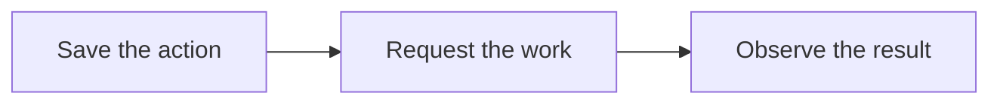

# Resource lifecycle

For operations such as starting or resizing a server, Central saves the request, asks the region to do the work and checks the result.

## Resource actions

A Resource Action is Central's record of a request. It holds who requested the work, its progress and the regional resource ID when one is available.

The console can receive a successful response while the action remains queued or in progress. Completion needs an observation from the service that performs the work.

| Operation | Confirmation |
| --- | --- |
| Start a VM | Atlas observes the requested runtime state. |
| Resize a VM | Atlas observes the requested machine shape. |

Atlas checks its records against host reports. Central follows the regional results for the customer's request.

Other operations track completion separately. A site rename finishes when Pilot's rename task completes. A domain route finishes when the proxy applies the change.

## Uncertain request outcomes

Suppose Central sends a create request but loses the connection before the answer. The region may already have created the VM.

Central keeps the action open and searches the team's regional resources for the original request. If it finds a matching VM, it uses that VM.

A completed search with no match can establish failure. An unreachable region leaves the outcome uncertain. Retrying creation immediately could create another server.

Once Central knows the VM's identity, it can retry the remaining work without creating another VM.

The [Resource Action contract](https://github.com/frappe/central/blob/develop/central/infrastructure/doctype/resource_action/SPEC.md) defines the exact states and recovery rules.

## Trials and paid service

Central owns trial timing, payment state, conversion, expiry and deletion. The in-app billing panel reads the same trial information as the console.

A trial can allow app use while server controls remain locked. Adding a payment method can start conversion, subject to the team's spending limit. Lifecycle work establishes paid service and removes the restrictions.

An eligible trial VM can sleep after inactivity. Customer traffic wakes it. Paid servers do not follow that trial sleep policy. Resuming a VM does not reinstall its apps.

Ended trials follow Central's retention and deletion policy.

## Snapshots and site backups

An Atlas VM snapshot saves the VM disk and can include memory. A Pilot site backup saves the site database and can include files. They have different scopes and restore procedures.

Cargo also takes VM snapshots to publish reusable images. An image build serves a different purpose from a customer's recovery snapshot.

Ownership stays consistent after creation. Central owns account actions and billing, Atlas owns regional VM work, Pilot owns site tasks and Cargo owns managed regional services.
