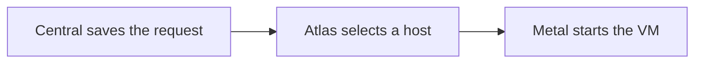

# Raw VM creation

A raw VM runs an operating system such as Ubuntu. The customer manages its software. Central and the region manage the VM and its account.

## Choose an image and machine

The customer selects a region, image offering and machine size. Central checks the team's permission and fetches matching available System images from Atlas.

An image offering describes the images a customer can choose using tags, such as the operating system. Atlas supplies matching regional images, their processor architecture and disk size. Central checks that the selected plan can hold the image. [App images](../regional/images.md#image-selection) explains how tags connect an offering to regional images.

The request can include a hostname, selected team SSH public keys and optional first-boot user data. Public IPv4, public IPv6 and the firewall are separate options when the region and Central configuration permit them.

## Create and observe the VM

Central records the request as a Resource Action and sends the VM configuration to Atlas. Atlas selects a host. Metal starts the VM from the chosen image.

The action tracks the VM's identity and state. A successful request does not mean the VM is running yet. [Resource lifecycle](./lifecycle.md) explains how Central follows the result and handles an uncertain response.

The raw VM does not need Pilot bootstrap, a Frappe site or a site-readiness check. The customer installs and manages their own application software.

## Access the VM

A public address, if selected, provides a network path to the VM. The customer's SSH public key can authorize SSH access when the guest's SSH service and network rules permit it. An address alone does not grant a login.

A team member with the `server:console` capability can also open the web console of a running server. The SSH mode opens a root shell with a temporary session key and needs the guest SSH service. The serial mode shows the guest's console and requires its login credentials.

When WireGuard gateway access is enabled for the VM, authorized devices can reach its private mesh address through the gateway. Firewall rules and guest authentication still apply.

Central's [server integration contract](https://github.com/frappe/central/blob/develop/spec/INTEGRATIONS.md) and [team SSH key guide](https://github.com/frappe/central/blob/develop/central/infrastructure/doctype/team_ssh_key/SPEC.md) define the current access behavior.
