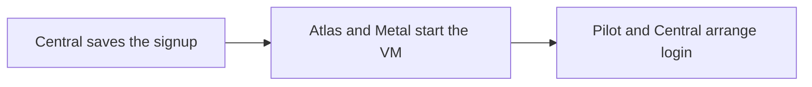

# Product signup

Product signup starts a prepared Frappe app for a customer. Central coordinates the VM, account and public address until the customer can enter the app.

Cargo builds the app image before signup. It already contains Pilot, Frappe, a site and the product apps. Central uses image tags and the product configuration to find a matching regional image and plan. [App images](../regional/images.md#image-selection) explains the selection.

## 1. Request validation

Consider a customer who selects ERPNext and chooses a site name. Central resolves the team and checks the requested product and name.

Central saves a **Resource Action**, a record that tracks the request and its progress. It prepares the server's Pilot credential and configuration before sending the request to the region.

The action records trial status at creation. A payment change during startup does not change that request halfway through.

## 2. VM startup

Atlas selects a physical host. Metal starts the VM from the chosen image. When a compatible warm template exists, the VM can restore prepared memory as well as its disk.

Pilot reads the VM's own metadata and applies its configuration. This is [bootstrap](./bootstrap.md). It establishes the server's Central connection and prepares the keys for management requests.

The apps are already installed. Startup still needs a working runtime, valid authentication and a public route.

## 3. Routing and login

### Route the site

Central observes the VM's mesh address and derives its automatic admin and site names. It creates the Site record and queues the route for the customer's chosen name.

The image's local site alias matches every name in the zone, so the chosen name reaches the prepared site before its directory rename. Central also asks Pilot to replace its local `admin.local` name with the automatic `admin-vm-<label>` name.

### Check readiness and arrange login

While the console waits, it asks Central for updates. Central checks whether the public site answers at `/api/method/ping`. When the site answers, Central sends Pilot a short-lived signed token for that site.

Pilot checks the token and creates the Frappe session. A trial team member signs in as their own user, which Pilot creates as a System Manager on first login.

Central returns a login URL on the chosen name once that name answers. Until then, it uses the automatic `site-<label>` name. If Pilot returns `401`, the site remains unclaimed. The console retries with backoff for about two minutes, plus the time taken by the requests. The browser does not receive Central's regional control credentials.

The first successful claim queues the physical site rename. That task can finish after the customer enters the app. [Domains](./domains.md) explains why this is safe.

## Signup milestones

| Milestone | Meaning |
| --- | --- |
| Creation accepted | Central saved the request. The VM may not exist yet. |
| VM Running | The regional runtime started the VM. The app can still be starting. |
| Site ready | The application answers through its public route. |
| Site claimed | The login handoff succeeded. |
| Rename completed | Pilot finished changing the site's physical name. |

A trial can provide app access while server controls remain restricted. Central owns conversion, expiry and deletion. [Resource lifecycle](./lifecycle.md) covers that lifecycle.

[Raw VM creation](./raw-vm.md) uses the regional VM path without Pilot bootstrap or a Frappe site.

The [fast-start path](./fast-start.md) explains how preparation reduces startup time. The owning contracts are [Central's signup rules](https://github.com/frappe/central/blob/develop/central/signups/SPEC.md) and [site lifecycle](https://github.com/frappe/central/blob/develop/central/infrastructure/doctype/site/SPEC.md).
