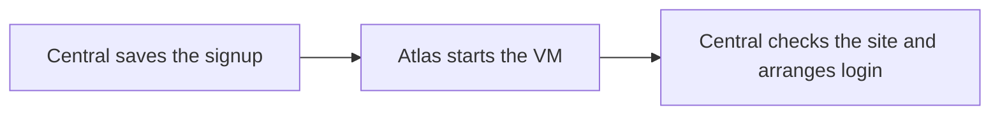

# Product signup

A product signup gives a prepared Frappe app its own VM, account identity and public address. Central coordinates the handoffs until the customer can enter the app.

Cargo builds the app image before signup. It already contains Pilot, Frappe, a site and the product apps. Central's product configuration selects the image and plan.

## 1. Request validation

Consider a customer who selects ERPNext and chooses a site name. Central resolves the team and checks the requested product and name.

Central saves a **Resource Action** to track the request and its progress. It prepares the server's Pilot credential and metadata before sending the regional request.

The action records trial status at creation. A payment change during startup does not change that request halfway through.

## 2. VM startup

Atlas selects a physical host. Metal starts the VM from the chosen image. A compatible warm template lets the VM restore prepared memory as well as its disk.

Pilot reads the VM's own metadata and applies its configuration. This is [bootstrap](./bootstrap.md). It establishes the server's Central connection and prepares the keys for management requests.

The apps are already installed. Startup still needs a working runtime, valid authentication and a public route.

## 3. Routing and login

Central observes the VM's mesh address and derives its automatic admin and site names. It creates the Site record and queues the route for the customer's chosen name.

The image's local aliases let that name reach the prepared site before its directory rename. Central also asks Pilot to claim its automatic admin name.

Central probes the public site's `/api/method/ping`. When the site answers, Central sends Pilot a signed site-login assertion.

Pilot checks the assertion and creates the Frappe session. Central returns a login URL on the site's public hostname. The customer's browser does not receive Central's regional control credentials.

The first successful claim queues the physical site rename. That task can finish after the customer enters the app. [Domains](./domains.md) explains why this is safe.

## Signup milestones

| Milestone | Meaning |
| --- | --- |
| Creation accepted | Central saved the request. The VM may not exist yet. |
| VM Running | The regional runtime started the VM. The app can still be starting. |
| Site ready | The application answers through its public route. |
| Site claimed | The login handoff succeeded. |
| Rename completed | Pilot finished changing the site's physical name. |

A trial can provide app access while server controls remain restricted. Central owns conversion, expiry and deletion. [After creation](./lifecycle.md) covers that lifecycle.

A raw VM uses the regional creation path without Pilot bootstrap, a Frappe site or a site-readiness check.

The [fast-start path](./fast-start.md) explains how preparation reduces startup time. The owning contracts are [Central's signup rules](https://github.com/frappe/central/blob/develop/central/signups/SPEC.md) and [site lifecycle](https://github.com/frappe/central/blob/develop/central/infrastructure/doctype/site/SPEC.md).
