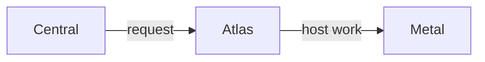

# How services communicate

Services exchange requests through APIs. Longer operations run in background jobs. Reports and state checks tell the caller what happened.

## Management requests

For a VM change, Central checks the customer's team and permission, saves the action and sends the regional request.

Atlas owns the regional VM record and selects a host. Metal performs the host operation. Each service changes the records it owns.

Reports return through the same ownership layers. Metal reports host state to Atlas. Atlas reports regional state to Central. The initial API response can arrive before all this work finishes.

## State reports

A **webhook** is an HTTP request that reports an event. Central registers a receiver and signing secret with the regional service.

Atlas delivers VM state. Cargo delivers managed-service state, including storage readiness and health. Central checks the signature before it uses a report.

Central also reads regional state to check progress and recover interrupted actions. A delayed webhook can describe an older observation, so receiving a report alone does not make it the latest state.

## Service connections

| Connection | Purpose |
| --- | --- |
| Central → Atlas | Create and change customer VMs. |
| Atlas → Metal | Run VMs and inspect host state. |
| Cargo → Atlas | Request build machines, service machines and snapshots. |
| Central → Cargo | Manage buckets and storage credentials. |
| Central → HTTP proxy | Add or remove customer domain routes. |
| Atlas → HTTP proxy | Configure regional service routes and proxy infrastructure. |
| Atlas → Cargo | Install Cargo and create Atlas's image-artifact bucket. |
| Cargo → HTTP proxy | Add `-svc` routes for Garage and other managed services. |
| Central → Pilot | Arrange login and manage the assigned runtime. |
| Pilot → Central | Call the allowed Cloud account methods. |
| Frappe site → Pilot | Request permitted operations for that site. |
| Pilot → Datum | Send metrics and logs. |

Each connection has its own credential and limits. The [service access matrix](../reference/token-validation.md#service-access-matrix) records those checks.

## Application traffic

The HTTP proxy forwards a visitor's request to the VM's stable mesh address. WG Mesh carries that traffic across physical hosts.

The proxy's control API updates route maps. Its serving process uses local routing information. It does not ask Central for each page request.

For regional domains, TLS ends at the proxy. For custom-domain HTTPS, TLS passes through to the VM. [Domains](../journeys/domains.md) follows this path in detail.

## Request completion

Acceptance records the request. Completion needs an observation from the service that performs the work.

A VM can be running while its app is still starting. A route can work while a site rename is pending. Central tracks these milestones separately, as the [signup flow](../journeys/signup.md) shows.
