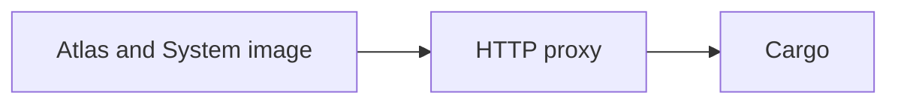
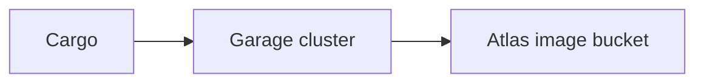

# Regional bootstrap

Regional bootstrap prepares a new region to run VMs and provide its services. It starts Atlas, connects physical hosts, and brings up the proxy, Cargo and object storage.

The order matters. A new region needs a VM image to start its first services. But the object storage that normally holds those images also needs VMs. Atlas breaks this loop by keeping the first System images as files on its own site.

## Start Atlas and prepare hosts

The `atlas-vm` installer starts Atlas in a Firecracker VM on a host. It configures the region and builds the initial System images. A System image is a shared operating system image that Atlas can use to start a VM.

Atlas initially stores these images as public site files. Metal hosts can download them from Atlas before regional object storage exists. Only System images can use this early storage path.

Atlas then connects to physical hosts and installs Metal. Metal runs and manages VMs on each host. The Atlas installer also sets up the wildcard DNS zone and certificate. The proxy needs a reserved tenant-0 public IPv4 address.

The [Atlas VM guide](https://github.com/frappe/atlas/blob/develop/scripts/atlas-vm/README.md) and [host setup guide](https://github.com/frappe/atlas/blob/develop/docs/region/index.md) cover the setup steps.

## Start the proxy and Cargo

Atlas uses a System image to create the regional HTTP proxy VM. The proxy must be Active before Atlas provisions Cargo.

Atlas creates the Cargo VM and installs Cargo through the VM's host. It then adds routes for Cargo and its Pilot service to the proxy. Atlas calls Cargo's ping endpoint through the proxy to check that the route and service respond.

When this check succeeds, Atlas marks Cargo **Active**. This does not mean that Garage is ready or that Atlas has a storage bucket. Those are separate steps.

## Start Garage and move the images

When Atlas installs Cargo, it passes a storage cluster plan: node sizes, node count and replication factor. Cargo's scheduler then asks Atlas for the Garage gateway and storage VMs, installs Garage, configures the cluster and adds its service routes to the proxy. Atlas also passes a telemetry plan, and Cargo creates the Datum host the same way.

Atlas waits for Garage to pass its health check. It then asks Cargo for an image bucket and saves the returned access details.

When Atlas receives the object storage settings, it queues the initial System images for migration from site files to the bucket. It keeps the old files for six hours so hosts can finish downloads already in progress. A job checks again every 15 minutes, so migration is complete when no Available image remains in site files. Metal can then download the images from object storage.

See [object storage](./storage.md) for how Cargo manages Garage and [Atlas image storage](https://github.com/frappe/atlas/blob/develop/docs/storage/image-records.md) for the migration details.

## Build app images and connect Central

When object storage is configured and no System image remains in site files, Atlas turns on Cargo's release tracking. Cargo then builds Pilot app images on temporary VMs from Atlas. Atlas stores the finished images for customer VM creation. [App images](./images.md) explains the build stages.

An operator runs **Test Connection** and **Enroll Atlas** on the Region in Central. Enrolling points Atlas's VM state reports at Central. Atlas installs Cargo with placeholder Central settings. Once Cargo answers its ping, Central registers it and sends a report receiver and signing secret. This can happen before storage is ready.

The region can therefore have an Active Cargo service before its storage is ready. Check each milestone separately.

## Access between services

The proxy, Cargo and other regional services run in service VMs with a special identity called tenant `0`. WG Mesh connects these VMs and the hosts. Some service VMs have permission to reach customer VMs across tenant boundaries.

Network access alone does not grant access to a service API. For example, Cargo uses an Atlas credential to request service VMs and a separate, restricted proxy credential to manage service routes. [Authentication and trust](../trust/authentication.md) explains how services check requests.

## Check setup progress

| Milestone | What to check |
| --- | --- |
| Atlas and hosts | Atlas is running, the System image is available, and Metal hosts are ready. |
| Proxy | The proxy service record is Active. |
| Cargo | The Cargo service record is Active and its ping through the proxy succeeds. |
| Storage | Garage is healthy, Atlas has its bucket settings, and image migration is complete. |
| App images | The required Cargo image builds are complete. |
| Central | The Region shows Atlas enrolled and Cargo registered. |

Service records move through states such as Pending, Provisioning, Active, Failed and Archived. A Failed record includes the failure phase. The related installation SSH Task contains setup output. A running VM does not necessarily mean the service inside it is ready.

The [regional bootstrapping discussion](https://gameplan.frappe.io/g/community/frappe-cloud/space/17/discussion/5827/cloud-v2-regional-bootstrapping) explains the original design. For current setup and recovery steps, see [service VMs](https://github.com/frappe/atlas/blob/develop/docs/region/service-vms.md) and [Cargo setup](https://github.com/frappe/atlas/blob/develop/docs/region/cargo.md).
