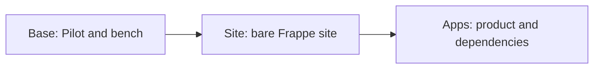

# App images

Cargo builds the machine images used for product signup. Each app image is a complete VM disk containing the Frappe runtime. Atlas stores the images and uses them to start customer VMs.

The region needs a System image before it can build app images. [Regional bootstrap](./bootstrap.md) explains where that first image comes from.

## Build stages

| Stage | What Cargo adds |
| --- | --- |
| Base | Pilot, the `frappe` bench user and a bench at the selected Frappe commit, on Ubuntu 24.04. |
| Site | A prepared `site.local` site on the Base image. |
| Apps | The product app and its required apps on a compatible Site image. |

Each completed image contains a full disk. A running VM does not depend on the earlier images.

Cargo records the Pilot version, Frappe branch and commit, and app releases. It installs required apps before the product app.

Prebuilt assets supply browser files for those commits. Cargo snapshots the build VM's disk, and Atlas stores it as the image.

## Image selection

Atlas keeps the images available in each region. Each image has **tags**: labels with a name and a value that describe what the image contains. Cargo adds tags to the Pilot images it builds.

| Tag | What it describes |
| --- | --- |
| `purpose=pilot` | The image contains Pilot. |
| `has_site=1` | The image contains a prepared Frappe site. `0` means it has a bench without a site. |
| `frappe_version` | The Frappe branch used to build the image. |
| `app` | The product app installed for signup, when present. |
| `pilot_version` and `app_<name>` | The Pilot release and installed app versions. |

Central defines an **image offering**, a customer-facing choice such as Ubuntu or Frappe. The offering specifies required tags. Central asks the selected region's Atlas for System images that match those tags. Every requested tag must match exactly, and the image must be enabled and available.

For a product signup, Central adds filters for a prepared site, the product's Frappe branch and its app. For example, an ERPNext signup can request `purpose=pilot`, `has_site=1`, `frappe_version=version-16-hotfix` and `app=erpnext`. The branch comes from the product configuration. An image must match all these values to qualify. It can also have other tags.

Central checks regions in name order and uses the first one that has a trial plan and a matching image. In that region it picks the newest image, preferring images older than the configured minimum age. A signup without a product uses a prepared site without a product app. If no eligible region has a matching image, the trial cannot start. Central sends the selected image ID to Atlas when it requests the VM.

The same tag system helps Cargo find an Ubuntu System image when it starts an image build. See [image offerings](https://github.com/frappe/central/blob/develop/central/infrastructure/doctype/image_offering/SPEC.md) for the current selection rules.

## Build process

Cargo asks Atlas for a temporary VM and runs the build script. Cargo records the build output in a Pilot Image record.

The script installs the stage's runtime, configures production processes and verifies the result. Cargo then:

1. If the builder is running, runs `sync` inside the guest to flush disk writes.
2. Stops the builder and waits up to five minutes for Atlas to report Stopped.
3. Requests the disk snapshot from Atlas.
4. Waits for the image to become available, then removes the build VM.

Cargo runs `sync` first because the guest can still hold buffered writes, and a forced stop would lose them. Missing writes can leave empty unit files or MariaDB files that need recovery. Atlas can force a stop when guest shutdown times out, so Stopped alone does not prove a clean MariaDB shutdown.

Base and Apps images are also marked for host caching and a warm memory template. The intermediate Site image stays disk-only. [Fast startup](../journeys/fast-start.md#image-preparation) explains warm preparation and its restore requirements.

A failed build records its step and error while Cargo cleans up the temporary VM. [Fast startup](../journeys/fast-start.md#disk-consistency) explains how a bad disk capture can delay later signups.

## Instance identity

The image waits for its configuration from Central. It has aliases for future public names, but no customer's Central credential.

A new VM receives its own metadata and applies it through [Pilot bootstrap](../journeys/bootstrap.md). [Domain aliases](../journeys/domains.md#local-hostname-aliases) let the prepared site answer before its directory rename.

## Release tracking

When **Track Pilot Releases** is on, Cargo checks every 2 hours for a new Pilot release or Frappe commit and starts a Base image. Site and Apps images start within about a minute once their inputs and prebuilt assets are ready. Cargo retries eligible failures and keeps the 3 newest completed builds for each Frappe branch, and the 3 newest Apps images for each signup app.

A new Site image does not rebuild every app image automatically. The next app release build selects a compatible completed Site image.

The build contract lives in [Cargo's image docs](https://github.com/frappe/cargo/blob/develop/docs/image.md). Related details are [Pilot assets](https://github.com/frappe/pilot/blob/develop/docs/prebuilt-assets.md) and [Atlas image storage](https://github.com/frappe/atlas/blob/develop/docs/storage/image-records.md).
