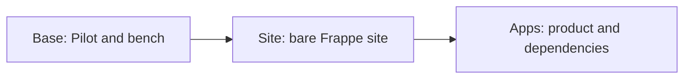

# App images

Cargo builds the machine images used for product signup. Atlas stores the images and starts customer VMs from them.

An app image is a complete VM disk containing the Frappe runtime. It differs from a Docker image or a bundle of browser assets.

## Build stages

| Stage | What Cargo adds |
| --- | --- |
| Base | Pilot, the bench user and an initialized bench at the selected Frappe commit, starting from Ubuntu. |
| Site | A prepared `site.local` site on the Base image. |
| Apps | The product app and its required apps on a compatible Site image. |

Each completed image contains a full disk. The stages describe the build order, rather than a runtime dependency on earlier images.

Cargo records the Pilot version, Frappe branch and commit, and app releases. It resolves required apps from the marketplace registry and installs dependencies first.

Prebuilt assets supply browser files for those commits. The VM snapshot is the output that Atlas starts.

## Build process

Cargo requests a temporary VM through Atlas, waits for SSH and runs the provision script. Build output streams into the Pilot Image record.

The script installs the stage's runtime, configures production processes and verifies the result. Cargo then:

1. Runs `sync` inside the guest to flush disk writes.
2. Stops the builder and waits for Atlas to report Stopped.
3. Requests the disk snapshot.
4. Retains the image identity and removes the build VM.

The flush is mandatory. Pausing a guest does not flush its filesystem cache. Unwritten files and database pages can produce a defective image.

A failed build retains its step and error while Cargo cleans up the temporary machine. [Fast startup](../journeys/fast-start.md#disk-consistency) explains how a bad disk capture can delay later signups.

## Instance identity

The image waits for Central bootstrap and contains aliases for future public names. It contains no customer's Central management credential.

A new VM receives its own metadata and applies it through [Pilot bootstrap](../journeys/bootstrap.md). [Domain aliases](../journeys/domains.md#local-hostname-aliases) let the prepared site answer before its directory rename.

Cargo also asks Atlas to cache artifacts and prepare warm memory templates. Atlas starts an isolated guest. The prewarm service loads local application paths before capture.

Base and Apps images use this warm path. The intermediate Site image is disk-only. Warm restore requires the template's CPU count and memory size, and a disk at least as large.

## Release tracking

When Cargo tracks releases, it creates missing build stages, checks assets, retries eligible failures and retires older images under its retention rules.

A new Site image does not rebuild every app image automatically. The next app release build selects a compatible completed Site image.

Central controls customer image selection. Cargo builds with a tenant-0 Atlas credential. Atlas supplies the machines and snapshots.

The build contract lives in [Cargo's image docs](https://github.com/frappe/cargo/blob/develop/docs/image.md). Related details are [Pilot assets](https://github.com/frappe/pilot/blob/develop/docs/prebuilt-assets.md) and [Atlas image storage](https://github.com/frappe/atlas/blob/develop/docs/storage/image-records.md).
