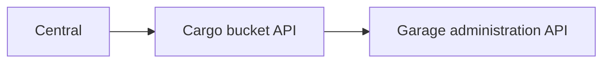
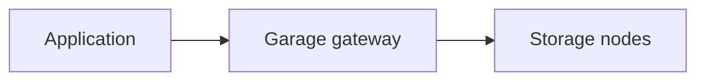

# Object storage

Garage is an open-source, S3-compatible object store. Cargo manages the regional Garage cluster. Central manages the customer offering and requests buckets and access keys.

## Cluster provisioning

Cargo asks Atlas for a gateway VM and storage VMs, then installs and configures Garage. Cargo owns cluster secrets and layout. Atlas owns the machines and connectivity.

Setup can be operator-driven or automatically provisioned. Automatic provisioning tracks allocated machines so another attempt can continue from existing work.

The Garage machines must join the cluster and receive a storage layout, which tells Garage which machine stores which data. The cluster needs enough storage machines to keep the configured number of copies.

Cargo creates proxy routes for the S3 and administration endpoints. The region permits one Active object storage cluster.

## Bucket management

Central checks the customer's access and calls Cargo's regional bucket API.

Cargo creates and deletes buckets. It also issues, replaces and deletes access keys. Central does not manage the Garage machines directly.

The credentials have separate purposes:

| Credential | Purpose |
| --- | --- |
| Cargo's Atlas token | Request service machines in tenant `0`. |
| Cargo's restricted proxy token | Manage service routes with the `-svc` suffix. |
| Central's Cargo token | Request bucket operations through Cargo. Central signs a new 5-minute token for each region. |
| Garage administration credential | Configure the cluster and its resources. |
| Customer S3 access keys | Access the authorized bucket's objects. |

## Object requests

Applications and backup tools send S3 requests to the regional endpoint. Object data follows its own path:

The regional proxy sends requests to the gateway. The storage machines hold the data and its copies according to Garage's configuration.

Cargo never handles object data. Central's console reads and deletes objects with the bucket's own key, and signs short-lived upload and download links that the browser uses directly.

## Registration, readiness and health

Atlas installs Cargo with placeholder Central settings, so Cargo reports nothing at first. When Cargo answers its ping, Central sends it a report receiver URL and a webhook signing secret. Central retries every 10 minutes.

Cargo sends signed service reports. Central checks them and records the endpoint and availability in its managed-service records.

A running process does not prove that Garage can accept files. Setup must finish so the cluster becomes Active, and Cargo then reports it to Central as available.

Cargo tracks lifecycle and health separately. It reports only lifecycle changes to Central. Cargo checks health every minute and keeps the result. A Critical result makes Cargo refuse new buckets.

Object storage can hold backups. Pilot still owns the site backup operation, schedule and restore process.

The owning docs cover [cluster provisioning](https://github.com/frappe/cargo/blob/develop/docs/object-storage.md), [health checks](https://github.com/frappe/cargo/blob/develop/docs/health.md) and [Central registration](https://github.com/frappe/central/blob/develop/central/infrastructure/doctype/region/SPEC.md).
