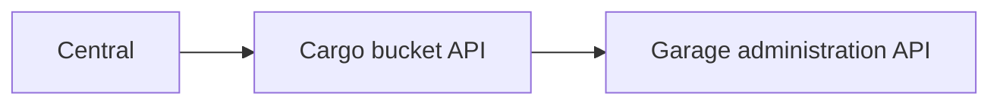

# Object storage

Garage provides regional S3-compatible object storage. Cargo manages its cluster. Central manages the customer offering and requests buckets and access keys.

## Cluster provisioning

Cargo asks Atlas for a gateway VM and storage VMs, then installs and configures Garage. Cargo owns cluster secrets and layout. Atlas owns the machines and connectivity.

Setup can be operator-driven or automatically provisioned. Automatic provisioning tracks allocated machines so another attempt can continue from existing work.

Garage needs its nodes to join and its storage layout to be applied. The cluster must have enough storage nodes for the configured replication factor.

Cargo creates proxy routes for the S3 and administration endpoints. The region permits one Active object storage cluster.

## Bucket management

Central checks the customer's access and calls Cargo's regional bucket API.

Cargo performs bucket creation and deletion, issues access keys and rotates or removes credentials. Central does not administer the Garage machines directly.

The credentials have separate purposes:

| Credential | Purpose |
| --- | --- |
| Cargo's Atlas token | Request service machines in tenant `0`. |
| Cargo's restricted proxy token | Manage service routes with the `-svc` suffix. |
| Central's Cargo token | Request bucket operations through Cargo. |
| Garage administration credential | Configure the cluster and its resources. |
| Customer S3 access keys | Access the authorized bucket's objects. |

## Object requests

Applications and backup tools send S3 requests to the regional endpoint. Object data follows its own path:

The endpoint reaches the gateway through the regional proxy. Storage nodes hold the data according to Garage's layout and replication settings.

Central and Cargo arrange the service and access. They do not process each S3 object request.

## Registration, readiness and health

Installing Cargo is one milestone. Central then registers its report receiver and webhook signing secret.

Cargo sends signed service reports. Central checks them and records the endpoint and availability in its managed-service records.

A configured process does not prove that Garage can accept objects. Setup must finish, and health checks must show that the running cluster is usable.

An Active cluster can later become unhealthy. Cargo tracks lifecycle and health separately and reports both as appropriate.

Object storage can hold backups. Pilot still owns the site backup operation, schedule and restore process.

The owning docs cover [cluster provisioning](https://github.com/frappe/cargo/blob/develop/docs/object-storage.md), [health checks](https://github.com/frappe/cargo/blob/develop/docs/health.md) and [Central registration](https://github.com/frappe/central/blob/develop/central/infrastructure/doctype/region/SPEC.md).
