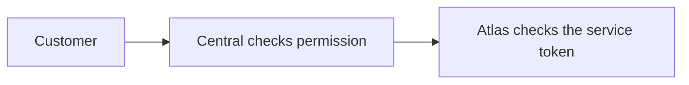
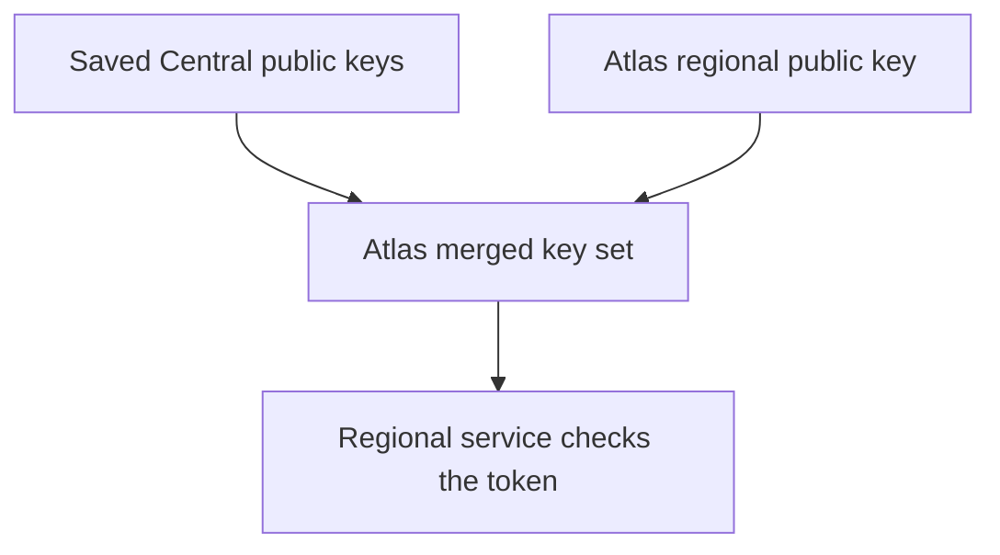

# Authentication and trust

Each service checks who sent a request and what they can do. These checks form the platform's trust boundaries.

**Authentication** checks identity. **Authorization** checks permission. An identity can be valid without permission for a particular action.

## Customer authorization

Customers request platform changes through Central. Central checks the user, the team that owns the resource and the permission needed for the action.

Central makes a separate regional request with its service credential. The browser does not receive that credential.

For example, a resize needs Central's permission check and Atlas's infrastructure check. Central's Atlas token is not tied to one tenant. Central sends the team's **tenant ID** in the `X-Tenant-ID` header, and Atlas limits the request to that tenant. A token that Atlas issues for Cargo carries a fixed tenant, and Atlas rejects a header that differs.

Central has broad regional authority. Atlas does not repeat Central's team-role model, so the customer permission check in Central is essential.

Access to a customer's app or VM follows approved workload paths. It does not grant regional control access.

## Service tokens

A **JWT**, or JSON Web Token, is a signed message. It contains fields called claims, such as who sent it and when it expires. The receiving service checks the signature and the fields it needs.

| Claim | Question it answers |
| --- | --- |
| Issuer | Who signed the token? |
| Audience | Is the token for this receiver? |
| Expiry | Is the token still valid? |
| Scope or access | What operations does the receiver permit? |

A proxy token does not grant Atlas VM control. Each service has its own accepted credentials and rules.

Metal uses mutual TLS instead: both ends check certificates, and the host accepts the pinned Atlas client identity.

## Regional public keys

A service signs tokens with a private key that it keeps secret. Other services use its public key to check those signatures. A **JWKS**, or JSON Web Key Set, is a list of public keys.

Atlas saves Central's public keys, adds its own regional key and publishes the merged set.

The receiving service uses the token's key ID to find a trusted public key. The key ID starts with its issuer, `central:` or `atlas:<region ID>:`, and the token's `iss` must match that prefix. A key therefore cannot sign for another issuer. The receiver then checks the signature, intended receiver, times and permission fields.

A valid signature shows that the holder of the matching private key signed the token and that its contents have not changed.

Atlas can sign regional tokens with its own private key. Its saved Central public keys cannot sign a new Central token. A trusted key alone does not grant access: each receiver still checks the audience and permission fields.

## Network partitions

A network partition is a break in communication between parts of the platform. For example, a region can lose its connection to Central while its own services keep running.

Atlas fetches Central's keys every 5 minutes. If a fetch fails or returns an invalid set, Atlas keeps the last valid set. Regional services fetch the merged set from Atlas and check tokens whose keys they already hold, without contacting Central for each request.

For example, Cargo can continue Atlas work with the tokens that Atlas signed for it.

| Condition | Result |
| --- | --- |
| Valid token and matching trusted key | The receiver checks it locally under normal access rules. |
| Receiver needs keys and can reach Atlas | It fetches the regional merged set. |
| Token expired or its key never reached the region | Validation fails. Cached keys do not extend token life. Atlas does not fetch keys for an unknown key ID. It waits for the next sync. |
| Work needs a new Central request or account decision | That operation still needs the Central connection. |

Receivers also have their own caches. If both Central and Atlas are unreachable, their cached keys determine what can continue.

A key that Central removes stays trusted in the region until a refresh succeeds. Its tokens still stop working when they expire.

Running app traffic uses the regional proxy and VM. Billing, new logins and new control requests have different dependencies.

The VM's clock must also be correct. [Clock restoration](../journeys/fast-start.md#clock-restoration) explains why a warm VM can reject an otherwise valid token.

## Pilot authentication

Central supplies each Pilot server's identity through instance metadata. The prepared image contains no customer's Central credential.

| Connection | Boundary |
| --- | --- |
| Central → Pilot | A signed token for the assigned Pilot audience and supported bench or site scope. |
| Pilot → Central | A server credential that Central resolves to its server and team. |
| Frappe site → Pilot | A token that Pilot signs with the bench's own secret, limited to one site and valid for up to a year. |

Pilot checks Central's tokens against Central's own JWKS, not the Atlas merged set, so Atlas is not in this path. It checks the signature, expiry and audience, but not the key-ID prefix or issuer rule.

Pilot keeps Central's keys on disk. A token signed by a cached key verifies without a fetch. Pilot refreshes the cache in the background after 60 seconds, and fetches for an unknown key ID at most once every 30 seconds. A failed refresh keeps the old keys.

In a partition, Pilot still accepts Central tokens signed by cached keys. Calls from Pilot to Central fail.

Pilot forwards only allowed Central methods for [in-app controls](../journeys/in-app-cloud.md). WG Mesh tenant boundaries add network restrictions, but reaching a service still does not grant API permission.

The [token validation reference](../reference/token-validation.md) lists every service connection, accepted claim and current validation limit.
