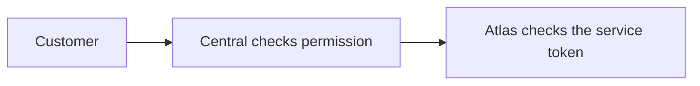
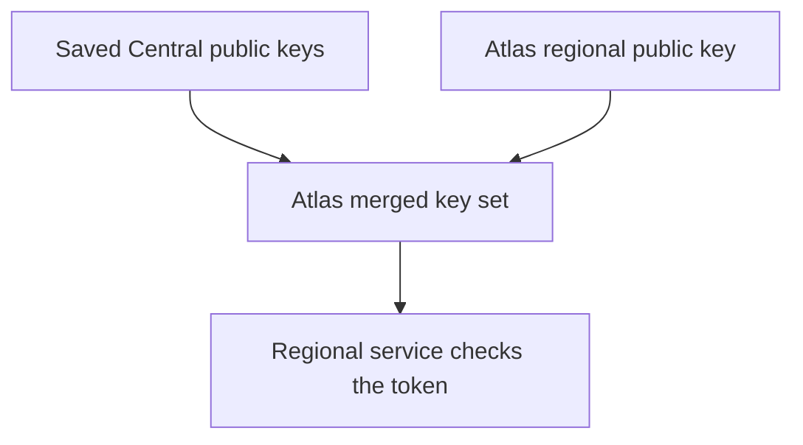

# Authentication and trust

Each service checks who sent a request and what that caller may do. Those checks define the platform's trust boundaries.

**Authentication** checks identity. **Authorization** checks permission. An identity can be valid without permission for a particular action.

## Customer authorization

Customers request platform changes through Central. Central checks the user, the owning team and the capability required for the action.

Central makes a separate regional request with its service credential. The browser does not receive that credential.

For example, a resize needs Central's permission check and Atlas's infrastructure check. Atlas uses the authorized team's **tenant identity** to limit regional resource access.

Central has broad regional authority. Atlas does not repeat Central's team-role model, so the customer permission check in Central is essential.

Access to a customer's app or VM follows approved workload paths. It does not grant regional control access.

## Service tokens

A **JWT**, or JSON Web Token, carries signed fields called claims. The receiver checks the signature and the claims relevant to its operation.

| Claim | Question it answers |
| --- | --- |
| Issuer | Who signed the token? |
| Audience | Is the token for this receiver? |
| Expiry | Is the token still valid? |
| Scope or access | What operations does the receiver permit? |

A proxy token does not grant Atlas VM control. Each service has its own accepted credentials and rules.

Metal uses mutual TLS instead: both ends check certificates, and the host accepts the pinned Atlas client identity.

## Regional public keys

The signer keeps a private key. Receivers use its public key to check signatures. A **JWKS**, or JSON Web Key Set, publishes public keys without exposing the private signing key.

Atlas saves Central's public keys, adds its own regional key and publishes the merged set.

The receiver finds a trusted key using the token's key ID. It checks the signature, issuer, audience, time claims and operation rules locally.

Atlas can sign regional tokens with its own private key. Its saved Central public keys cannot sign a new Central token.

## Network partitions

A network partition can break the Central-to-region link while the regional services remain available.

If Central's key refresh fails, Atlas retains the last valid set. Regional services can fetch that set from Atlas and check known tokens without contacting Central per request.

For example, Cargo can continue Atlas work with existing valid regional credentials.

| Condition | Result |
| --- | --- |
| Valid token and matching trusted key | The receiver checks it locally under normal access rules. |
| Receiver needs keys and can reach Atlas | It fetches the regional merged set. |
| Token expired or its key never reached the region | Validation fails. Cached keys do not extend token life. |
| Work needs a new Central request or account decision | That operation still needs the Central connection. |

Receivers also have their own caches. If both Central and Atlas are unreachable, available cached keys and receiver behavior determine what can continue.

Running app traffic uses the regional proxy and VM. Billing, new logins and new control requests have different dependencies.

The VM's clock must also be correct. [Clock restoration](../journeys/fast-start.md#clock-restoration) explains why a warm VM can reject an otherwise valid token.

## Pilot authentication

Central supplies each Pilot server's identity through instance metadata. The prepared image contains no customer's Central credential.

| Connection | Boundary |
| --- | --- |
| Central → Pilot | A signed assertion for the assigned Pilot audience and supported bench or site scope. |
| Pilot → Central | A server credential that Central resolves to its server and team. |
| Frappe site → Pilot | A site-scoped token for that site's allowed operations. |

Pilot uses its configured JWKS source and audience. It does not use the regional validator's key-ID and issuer rules.

Pilot forwards only allowed Central methods for [in-app controls](../journeys/in-app-cloud.md). WG Mesh tenant boundaries add network restrictions, but reaching a service still does not grant API permission.

The [token validation reference](../reference/token-validation.md) lists every service connection, accepted claim and current validation limit.
